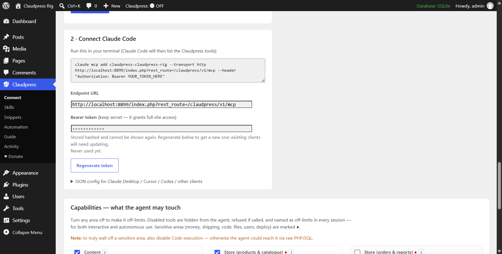
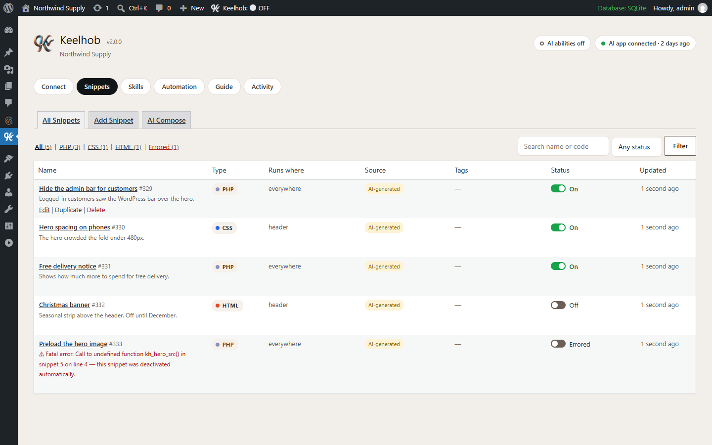
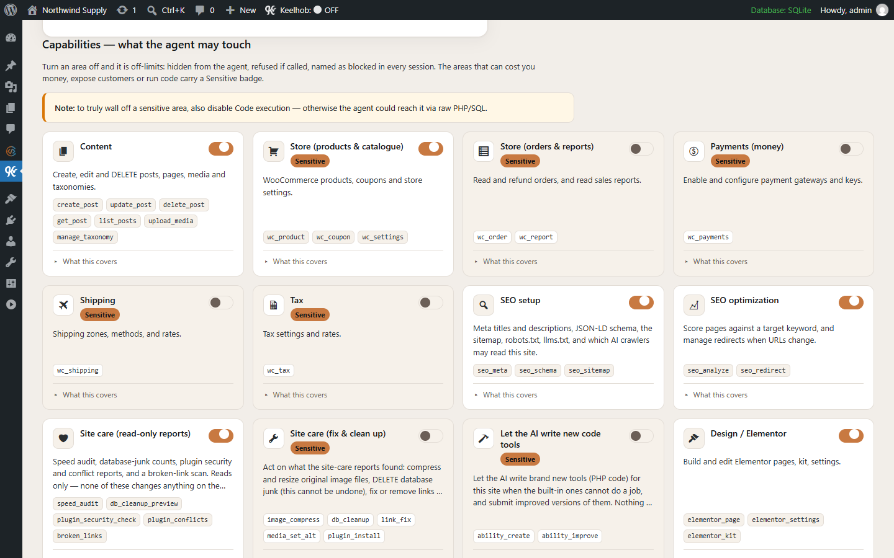

<div align="center">

# Claudpress

**Build your WordPress site or store from one prompt. Free, forever.**

[](https://github.com/calflint/claudpress/actions/workflows/ci.yml)
[](LICENSE)
[](https://ko-fi.com/claudpress)
[](ROADMAP.md)

</div>

<!-- TODO(owner): record — three-minute unedited demo, then replace this block with the embed. Recipe: docs/img/SHOT-LIST.md -->
> **Demo video — not recorded yet.** Three minutes, one take, no cuts: a fresh WordPress, the zip
> installed, an agent connected, one prompt, a finished site. Recipe in
> [docs/img/SHOT-LIST.md](docs/img/SHOT-LIST.md).

WordPress promised that anyone could build a site in an afternoon. AI site builders are quietly
taking that promise away — and taking WordPress users with it. Claudpress hands it back, with a
database, a store, and code you actually own.

Install one plugin, connect Claude Code (or Claude Desktop, Cursor, Codex, any MCP client), and say
what you want. It asks a few questions, then builds: pages, products, checkout, SEO, snippets,
media. Don't want to run a client at all? Add your own API key and the site runs itself — on a
schedule, or from a Telegram chat with voice notes, screenshots and approve-by-button. Tool-by-tool
tour: **[docs/features.md](docs/features.md)**.

## What it cannot do yet

- **No onboarding wizard.** Activation drops you on an admin page; connecting an agent is a
  copy-paste step you do yourself.
- **No independent security audit.** ~1,500 unit assertions and a live rig against real WordPress,
  and nobody outside this project has read the code. Commissioning that is the top line in
  [FUNDING.md](FUNDING.md).
- **Permissions are coarse.** Capability groups, on or off — no per-tool approval and no queue
  that asks before a destructive action runs.
- **No rollback.** `/undo` reverses one turn and only content: posts, pages, products. Not
  settings, plugins, files or live snippets. Nothing snapshots the site, so backups are yours.
- **Block themes and full site editing are not supported.** Pages are built with Gutenberg,
  Elementor, or custom-coded page templates.
- **Nothing migrates in** — no Shopify, Wix or Squarespace import. Going the other way, a variable
  product only half-migrates between Claudpress sites: the page moves, its attributes and
  variations do not, and the import says so.
- **One agent at a time**, no background job queue: a long interactive build lives inside the
  session that started it. **Not translated**, either — strings are wrapped, no translation ships.
- **Telegram needs a public HTTPS URL** with a valid certificate — a localhost or self-signed
  staging site cannot receive messages.
- **Not on WordPress.org**, and it will not be: the directory does not allow a plugin that executes
  arbitrary PHP. Install the zip; it updates itself from GitHub releases.

[ROADMAP.md](ROADMAP.md) says which of these are being fixed, and in what order.

## Screenshots

<!-- TODO(owner): capture — docs/img/SHOT-LIST.md gives the exact state each shot must be in -->

| | |
|---|---|
| <br>**Connect** — the ready-to-paste command, with this site's URL and token already in it. | <br>**Snippets Studio** — every piece of code the agent installed, why it exists, and its off switch. |
| <br>**Capabilities** — twenty-one groups, eight of them off, each saying what it unlocks. | <br>**The output** — a store built from one prompt: pages, products, checkout and SEO. |

## Why it is free

Claudpress was built as a free core with a paid add-on beside it. The paid version was designed,
built and finished — payments, orders, deploy, the Snippets Studio, six expert skills — and then
given away, because a plugin whose whole point is handing people back a promise should not take
part of that promise away again at a checkout. It runs on donations instead. Every feature is in
this repository: no paid tier, no locked capability, no trial, no upsell in the admin, and no
telemetry beyond an update check you can switch off ([exactly what it sends](PRIVACY.md)).

**[Support Claudpress on Ko-fi](https://ko-fi.com/claudpress)** — or star the repo, report a bug,
or write a skill. Skills are plain markdown; no PHP needed.

## Install

1. Download `claudpress.zip` from the [latest release](https://github.com/calflint/claudpress/releases).
2. WordPress admin → **Plugins → Add New → Upload Plugin** → the zip → **Install Now** → **Activate**.
3. Open **Claudpress** in the admin menu.

Requires WordPress 6.3+ and PHP 8.0+. WooCommerce and any SEO plugin (Yoast, Rank Math, AIOSEO,
SEOPress) are auto-detected if present; none are required. **Claudpress → Connect** then prints a
ready-to-paste command with your real URL and token in it:

```bash
claude mcp add claudpress-yoursite --transport http https://yoursite.com/wp-json/claudpress/v1/mcp --header "Authorization: Bearer cp_xxxxxxxx"
```

Run it, start a new session, and the tools appear. Try *"list the plugins on this site"*. The
same page outputs a JSON `mcpServers` block for Claude Desktop, Cursor and Codex; authenticate
with the bearer token or a WordPress Application Password.

## How risky this is, honestly

A connected agent can write PHP, read your database and change your files. That is the product,
not a defect. So the answer is not "staging only" — it is graded, and this is the grading.

**Eight capability groups ship switched off**, and are forced off once on any site still carrying
settings from the old free/paid split, so an automatic update cannot quietly hand them over:

| Group | Off because it can |
|---|---|
| `store_orders` | read and refund real orders, and read sales reports |
| `payments` | enable and configure payment gateways and their keys |
| `shipping` | change shipping zones, methods and rates |
| `tax` | change tax settings and rates |
| `users` | create, edit and delete user accounts and roles |
| `updates` | update WordPress core, plugins and themes |
| `comms` | send email to real addresses, including your customers |
| `deploy` | export a bundle and push it to your production site |

**What stays on** is what a build needs, and none of it is harmless: `content` writes posts, pages
and media · `store` creates products, coupons and store settings · `seo` and `seo_optimize` write
meta, schema, sitemap and redirects · `design` builds Elementor pages · `snippets` installs code
that runs on every page load · `code_exec` runs arbitrary PHP and SQL · `files` reads and writes
under a configurable base · `site_admin` changes options and activates plugins and themes ·
`images` searches and generates media · `automation` runs unattended agent loops · `memory` and
`skills` write what the agent remembers and follows. Above all of them sits one master switch:
with **AI abilities** off the endpoint authenticates but exposes only read-only introspection.
Every call is written to the Activity log.

**Before pointing this at anything you care about:** a backup you have actually restored once, not one
you assume works; a staging copy for the first build, so you can watch what it does; only the capability
groups the job in front of you needs; and the endpoint token treated like a root password, because it
is one — stored hashed and shown once, so regenerate it the moment it leaks.

**Zero external dependencies at runtime.** No Composer, no npm, no vendored libraries, no bundled SDK —
the plugin runs from its own source, so there is no supply chain underneath it to compromise. For
software with this much reach that is worth more than any feature. [SECURITY.md](SECURITY.md) covers
what is in scope and how to report something.

## About `eval()`

Grep this repository and you will find `eval()` three times: `includes/class-snippets.php` (lines
391 and 407) and `includes/tools/class-tools-core.php` (line 71). That is the product working as
designed, not an oversight — `execute_php` is the escape hatch that lets an agent do anything
WordPress can do without waiting for a dedicated tool, and the snippet engine is how AI-written
code becomes site code that runs for real visitors. What is built around it: a PHP snippet is
parse-checked with `token_get_all(TOKEN_PARSE)` before it can ever be active, and code that fails
the check is still saved — you do not lose the work — but is forced inactive with the parse error
attached. A snippet that fatals at runtime is switched off by a shutdown handler that knows which
snippet was executing, with the error written to its row, to the snippet log and to the PHP error
log, and an event fired so the site can tell you. The snippet tools sit in the `snippets`
capability group and `execute_php`/`execute_sql` in `code_exec`: switch either off and those tools
disappear from the agent's tool list and are refused if called anyway. Snippets already saved keep
running regardless, because by then they are site code — the separate **Run code snippets** setting
is the kill switch that stops every one of them at once.

## Skills and memory

**Skills** are markdown playbooks stored in WordPress that the agent loads when a task matches their
description; fifteen ship with the plugin, and you can write your own from the agent — *"create a
skill that…"* — with no PHP. **Memory** is per-site key/value knowledge every connected agent shares
(*"remember: primary color is #f8ca50"*).

## Development

The plugin runs from source; there is nothing to build.

```bash
php tests/run.php                 # unit suite, ~1,500 assertions, no composer, no WP install
bash bin/build-zip.sh             # → build/claudpress.zip
```

CI lints every PHP file on 8.0–8.4, runs the suite on 8.0/8.3/8.4, then builds the zip and asserts
its layout. Module map, test strategy and the MCP transport: **[docs/architecture.md](docs/architecture.md)**.

## Who builds this

Built and maintained by [calflint](https://github.com/calflint), in evenings around a full-time
job. Bug reports, skills, translations and pull requests are wanted and credited by name —
[CONTRIBUTING.md](CONTRIBUTING.md) has the setup and what "done" means here.

## More

[Roadmap](ROADMAP.md) · [Funding](FUNDING.md) · [Contributing](CONTRIBUTING.md) ·
[Security](SECURITY.md) · [Privacy](PRIVACY.md) · [Code of conduct](CODE_OF_CONDUCT.md)

GPL-2.0-or-later. Inspired by [Novamira](https://novamira.ai), rebuilt from scratch with no
external dependencies and no WordPress 6.9 requirement. Built with Claude Code.
